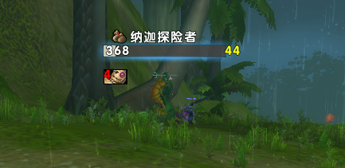
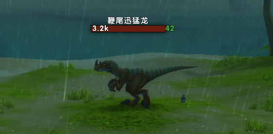
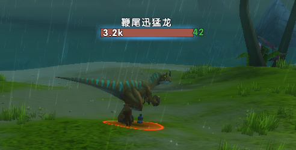
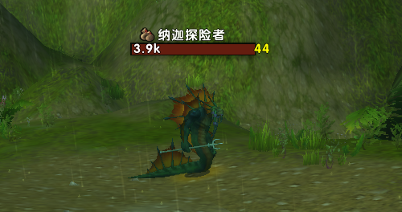
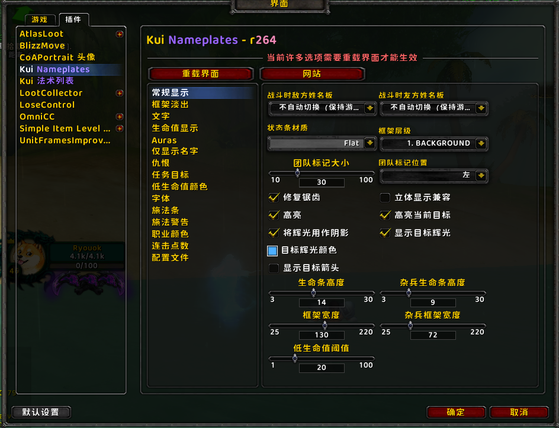
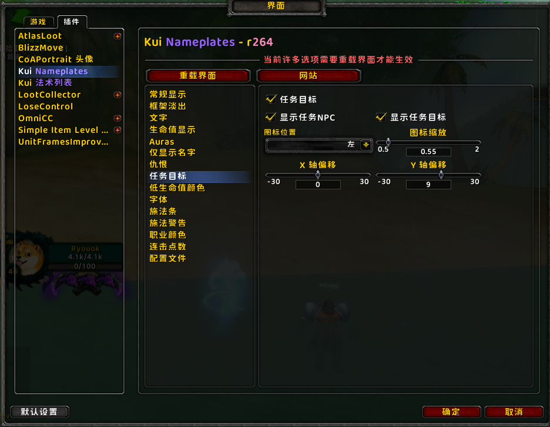
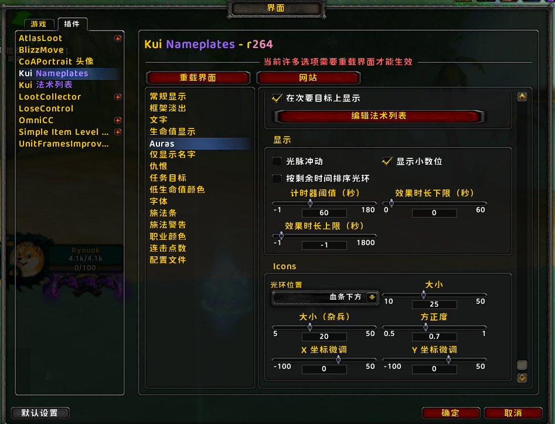

# Kui_Nameplates-CN

适用于飞升魔兽（Ascension）Arden 客户端的 Kui Nameplates 简体中文版。包含姓名板主插件 `Kui_Nameplates` 和光环子插件 `Kui_Nameplates_Auras`。

## 功能与修复

- **简体中文汉化**：补充并修正姓名板和光环模块的选项、提示及说明，涵盖战斗时姓名板的显示规则、任务图标和光环设置。
- **姓名板任务图标**：在相关怪物名字旁显示任务目标。袋子表示该怪物掉落所需任务物品，匕首表示需要击杀该怪物。也支持在任务 NPC 姓名板上显示可接取和可交付任务的图标。可在插件设置中调整图标位置与大小。
- **修复怪物血条串入玩家增益**：修正了姓名板匹配时将两个空字段误当成同一块姓名板的问题。客户端提供姓名板映射接口时，查不到对应姓名板就跳过这次光环更新，避免使用可能错绑的 GUID 缓存。更新时校验单位归属，敌对姓名板的战斗日志路径过滤增益事件，姓名板隐藏时清理旧图标和计时。怪物实际受到的减益仍按光环设置显示。

## 安装

1. 在仓库页面选择 **Code → Download ZIP**，然后解压。
2. 将解压后的 `Kui_Nameplates` 和 `Kui_Nameplates_Auras` 两个文件夹直接放进游戏的 `Interface/AddOns`。每个插件的 `.toc` 文件应位于对应的插件文件夹内。
3. 登录游戏前，在角色选择界面的「插件」列表启用这两个插件。如果游戏已经打开，安装后重新启动客户端。

`Kui_Nameplates_Auras` 依赖 `Kui_Nameplates`。任务图标功能使用飞升客户端的任务数据。

## 效果图

**任务物品图标与减益显示**

**普通敌方姓名板**

**选中目标时的姓名板**

**任务物品图标**

## 设置界面

**常规显示**

**任务目标**

**光环设置**

## 致谢

Kui Nameplates 原作者为 Kesava，3.3.5 版本由 Kader 移植。本项目基于 [KuiNameplates-WoTLK](https://github.com/bkader/KuiNameplates-WoTLK) 做简体中文与飞升客户端适配。
